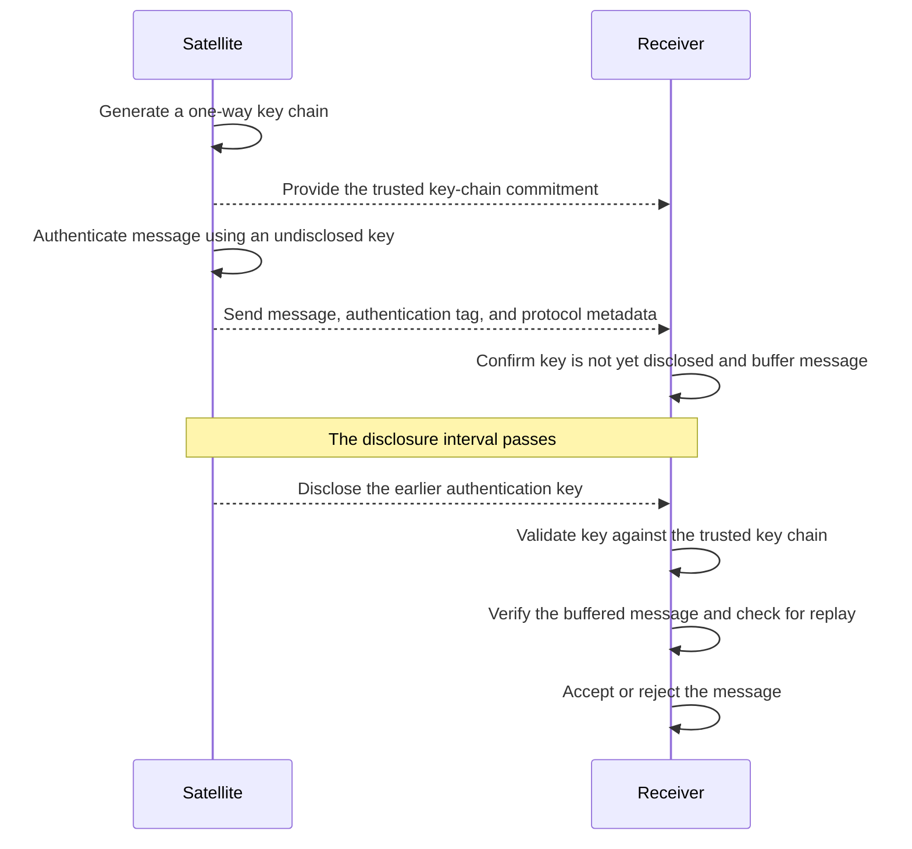

# Mini-TESLA in Java

Complete Java implementation of the challenge below. Requires **JDK 17 or later**. Production code uses only the JDK (`SHA-256`, `HmacSHA256`, `AES/GCM/NoPadding`, and `SecureRandom`). Tests use **JUnit Jupiter 5.11.4**. Maven 3.6.3+ is optional; the PowerShell runner downloads a standalone JUnit runner for tests. No database or server is needed.

## Run on Windows

From this project directory, create a random master key in the current shell without printing it:

```powershell
$keyBytes = New-Object byte[] 32
$rng = [System.Security.Cryptography.RandomNumberGenerator]::Create()
$rng.GetBytes($keyBytes)
$rng.Dispose()
$env:TESLA_MASTER_KEY = [Convert]::ToBase64String($keyBytes)

powershell -NoProfile -ExecutionPolicy Bypass -File .\run.ps1 demo
powershell -NoProfile -ExecutionPolicy Bypass -File .\run.ps1 demo -Verbose
powershell -NoProfile -ExecutionPolicy Bypass -File .\run.ps1 test
```

The execution-policy override applies only to the child process. The demo writes `demo.hsm` in the project directory. Retain the same master key securely if you want to import that file later; generating a different key makes old exports unreadable. The application requires the environment variable and never creates a default master key.

With Maven, after setting the environment variable:

```text
mvn clean verify
java -jar target/mini-tesla-1.0.0.jar
java -jar target/mini-tesla-1.0.0.jar --verbose
```

On Linux/macOS, a shell can set the key with `export TESLA_MASTER_KEY="$(openssl rand -base64 32)"` before using Maven. Never commit the key or store it alongside the encrypted file.

## Design

* `Hsm` encapsulates all cryptography, sender keys, disclosed receiver keys, sequence allocation, and encrypted persistence. Satellite and Receiver use separate instances. Authentication never returns a secret key. Sender key access is limited to `disclose`, which checks the trusted schedule.
* For N intervals, the sender generates a random 32-byte K[N] and hashes backwards: K[i] = SHA-256(K[i+1]). K[0] is the public commitment; interval i uses K[i+1]. The receiver hashes a disclosed key i+1 times and compares it with K[0] using `MessageDigest.isEqual`.
* `Protocol.Trust` contains a session UUID, start time, interval length, disclosure delay, interval count, and commitment. This entire configuration must be supplied through an authenticated, trusted bootstrap channel. Direct construction in the demonstration models that channel. Packets cannot update it.
* MAC input is an ASCII version/domain marker, UUID as two big-endian 64-bit values, big-endian 32-bit interval, 64-bit sequence, 32-bit payload length, then exact payload bytes. All packet metadata affecting authentication is protected. Arrays are defensively copied.
* Interval i opens at `start + i * duration`; its key can be disclosed at `start + (i + delay) * duration`. Receiver buffers a packet only when its local arrival time is within the permitted window and `arrival + clockUncertainty < disclosureTime`. A packet arriving exactly at disclosure time is rejected. A missing disclosure packet does not extend this window.
* A validated disclosure verifies buffered messages for that interval. Invalid keys leave buffered messages intact; bad MACs do not consume sequence numbers. Only authenticated, accepted sequence numbers enter the replay set. Duplicate buffered packets are accepted at most once. Disclosures may arrive out of order; each is checked against the commitment.
* Buffers are capped at 1,024 packets, payloads at 64 KiB, and chains at 10,000 intervals. Malformed record construction throws an argument exception; protocol rejection returns explicit statuses. AES import rejects malformed files and fails authentication on incorrect keys or ciphertext tampering.
* Store exports contain the trusted configuration, sender chain when present, next sequence, and validated disclosed keys. AES-256-GCM uses a fresh random 12-byte nonce, a 128-bit tag, and an authenticated version header. A temporary encrypted file is replaced atomically where supported. Import checks chain consistency before returning a new HSM; authentication failures return no state.

## Demonstration and verification

`Demo` advances an injected simulation clock, so there are no sleeps. Its output shows `BUFFERED`, then `ACCEPTED` after disclosure; a modified message becomes `BAD_MAC`; an invalid key becomes `BAD_KEY`; an accepted replay becomes `REPLAY`; a second interval authenticates successfully; and an encrypted store is exported and imported.

Fourteen automated tests cover those scenarios plus tag/metadata tampering, delayed disclosure delivery, clock uncertainty, duplicate buffering, disclosure reordering, wrong sessions, malformed packets, defensive copies, buffer limits, encrypted round trips, fresh export nonces, sequence continuity, ciphertext tampering, and optional tracing.

### Follow the execution with verbose mode

Enable `-Verbose` in PowerShell demo mode, or pass `--verbose` directly to `Demo`. This adds explanations from `[DEMO]`, `[CLOCK]`, `[SATELLITE]`, `[SENDER HSM]`, `[RECEIVER]`, and `[RECEIVER HSM]` as each operation happens. It shows the trusted schedule, arrival checks, key-chain validation, MAC results, replay decisions, and encrypted export/import. For example:

```text
[RECEIVER] BUFFERED sequence=0; arrival is safe, but authentication awaits a validated disclosed key.
[CLOCK] Advanced time from 1000 ms to 2000 ms.
[RECEIVER HSM] Key-chain validation passed for interval=0; key stored for verification.
[RECEIVER HSM] MAC verification passed for sequence=0.
[RECEIVER] ACCEPTED sequence=0: MAC matches; sequence recorded for replay protection.
```

After setting `TESLA_MASTER_KEY`, run from the project directory:

```powershell
# Script interface (process-only execution-policy override if required)
powershell -NoProfile -ExecutionPolicy Bypass -File .\run.ps1 demo -Verbose

# Java interface after compiling; an optional positional argument selects the store file
java -cp target/classes com.vyomic.tesla.Demo --verbose
java -cp target/classes com.vyomic.tesla.Demo --verbose custom.hsm
```

In an IDE, add `--verbose` to the program arguments for `Demo` and set the environment variable in its run configuration. Omitting the option keeps the original concise demo output. Existing component constructors disable tracing; callers that want tracing can pass one shared `Trace.console(System.out)` to the constructor overloads. The `-Verbose` script option applies only to demo mode; automated tests use captured traces internally where needed. Built-in trace events print explanations and public numeric metadata, never payload bytes, tags, keys, the master key, or decrypted key-store contents.

## Security scope and limitations

This is a software HSM simulation, not a hardware security boundary: process memory, reflection, or a compromised JVM can expose keys. Real deployment needs an authenticated bootstrap, a trustworthy clock with a known satellite-time error bound, and monotonic time behavior. The simulated clock is for tests and demonstration only. Anyone knowing a disclosed key can forge its interval's MAC; the receiver's pre-disclosure arrival check is therefore essential.

HSM persistence does not persist Receiver buffers or its accepted replay set. On receiver restart, bootstrap a fresh session instead of resuming old application state. Encrypted files do not prevent rollback to an older valid export; do not restore an old sender snapshot into an active session. The GCM file format provides confidentiality and integrity, not freshness. Filesystem permissions and environment-key delivery are deployment responsibilities. Missing disclosures can occupy the bounded buffer; session lifecycle and eviction policies are outside this simulator's scope.

The project implements the simplified challenge, not the full TESLA or Galileo OSNMA specifications. All requested local components are implemented. Push the project to your GitHub repository when submitting.

---

# Original Technical Challenge: Mini-TESLA Message Authentication

## Overview

The goal of this challenge is to design and implement a simplified **TESLA-based message authentication protocol**.

The cryptographic operations and key material must be encapsulated in an **HSM class** that mimics some of the key-protection properties of a Hardware Security Module.

You will build a **Satellite and Receiver simulator**. The Satellite will create authenticated messages and later disclose their authentication keys, allowing the Receiver to validate the keys and authenticate the buffered messages.

---

## Requirements

### Core Cryptographic Engine

Implement the cryptographic operations in an **HSM class** using appropriate cryptographic libraries for your chosen language.

The HSM must support the following capabilities:

- **Secure Key Generation:** Generate key material using a cryptographically secure source of randomness.
- **One-Way Key Chain:** Generate a SHA-256 key chain and validate disclosed keys against its trusted commitment.
- **Message Authentication:** Generate and verify message authentication codes using HMAC-SHA256.
- **Key Protection:** Keep authentication keys internal during MAC generation and expose them only through an explicit key-disclosure operation.

### Satellite and Receiver

The application must contain two logical participants implemented as separate components:

- A **Satellite** that creates the key chain, authenticates messages, and discloses authentication keys after a delay.
- A **Receiver** that receives and buffers authenticated messages, validates disclosed keys, and then accepts or rejects the buffered messages.

The Satellite and Receiver must each use a separate instance of the **HSM class** for the cryptographic operations they require.

They must use a deterministic byte representation for all message fields protected by the MAC.

The Satellite and Receiver may run within the same application process. They may communicate through direct method calls or through a small demonstration program. A network server, HTTP API, gRPC service, message broker, or external communication channel is not required.

### Authentication Sequence

The expected interaction is shown below:



### Authentication Flow Demonstration

Provide a small demonstration of the sequence shown above.

The demonstration must include:

- A valid message being authenticated after its key is disclosed
- A modified message or authentication tag being rejected
- An invalid disclosed key being rejected
- A previously accepted message being replayed and rejected
- More than one message and disclosure interval being processed

The demonstration script or tests may copy, modify, delay, duplicate, reorder, or replay packets before passing them to the Receiver.

### Persistence & Security at Rest

- **Export/Import:** The HSM must support exporting its key store to a local file and importing it again without using an external database.
- **Encryption at Rest:** The exported file must be encrypted using **AES-256-GCM**.
- **Master Key:** The master encryption key must be passed to the application through an environment variable.

---

## Constraints

- **Language:** Use a programming language of your choice. Clearly document the language version and required dependencies.
- **Cryptography:** Use established cryptographic libraries available for your chosen language. Do not implement cryptographic primitives manually.
- **No External Databases:** Use in-memory state with the required encrypted file-based HSM export/import.
- **Testing:** Use an appropriate automated testing framework for your chosen language.
- **Security:** Undisclosed authentication keys must not be exposed to the Receiver before their disclosure interval.
- **Scope:** The candidate is not expected to implement the complete TESLA or Galileo OSNMA specifications.
- **Time Expectation:** Complete and submit the challenge within **2 calendar days**. If any portion is incomplete, clearly document the intended design and remaining work.

---

## Evaluation Criteria

We will evaluate your submission based on:

- **Security Mindset:** Correct reasoning about secret keys, trust establishment, key disclosure, and attacker-controlled packets.
- **Authentication Protocol:** Correct use of the one-way key chain, HMAC, delayed key disclosure, and replay protection.
- **Key Management:** Secure handling, export, and import of HSM key material.
- **Protocol Design:** Clear handling of intervals, protocol state, and failure conditions.
- **Code Quality:** Idiomatic code in the chosen language, clear project structure, automated tests, and comprehensive error handling.
- **Resilience:** How the Receiver handles malformed packets, modified messages, invalid keys, and replay.

---

## Submission Instructions

1. Everything must be pushed to your **GitHub repository**.
2. Provide a `README.md` explaining the design and how to run the demonstration.
3. Include automated tests and instructions for running them.
